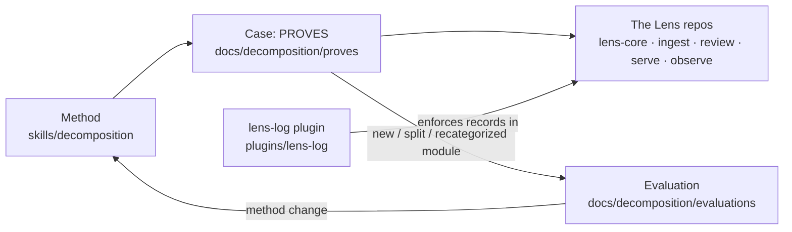

# Surveyor

The **decomposition component**: it identifies structures, interfaces, and knowledge types
within the systems people work with. This repo holds the method, the tooling that keeps
decomposition work recorded and checkable, the evaluations of the method, and the running
records of each case.

- **Identity:** [`CHARTER.md`](CHARTER.md)
- **Orientation:** [`docs/BUILD.md`](docs/BUILD.md)
- **The method:** [`skills/decomposition/SKILL.md`](skills/decomposition/SKILL.md)
- **The log plugin:** [`plugins/lens-log/DESIGN.md`](plugins/lens-log/DESIGN.md), installed
  from the `lizo-skills` marketplace as `lens-log@lizo-skills`

Licensed Apache 2.0.
