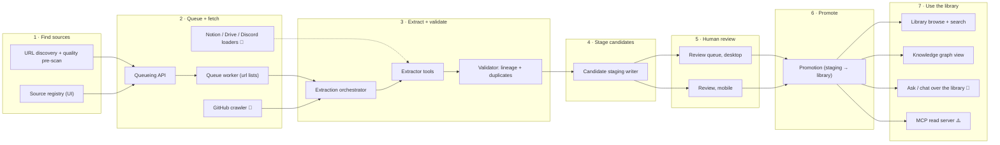
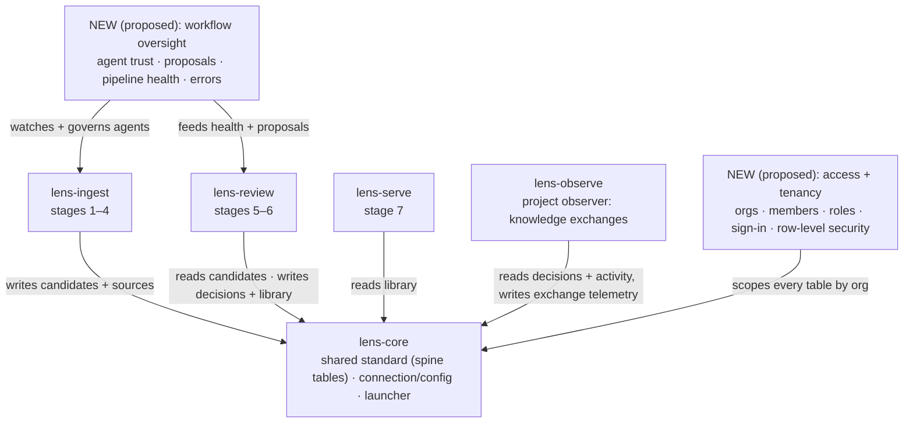
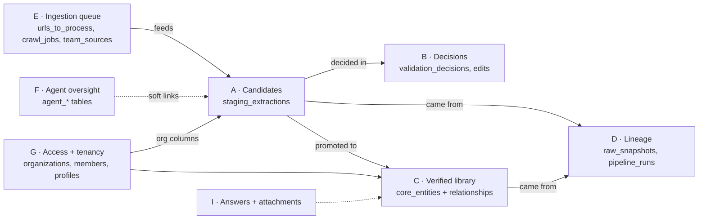
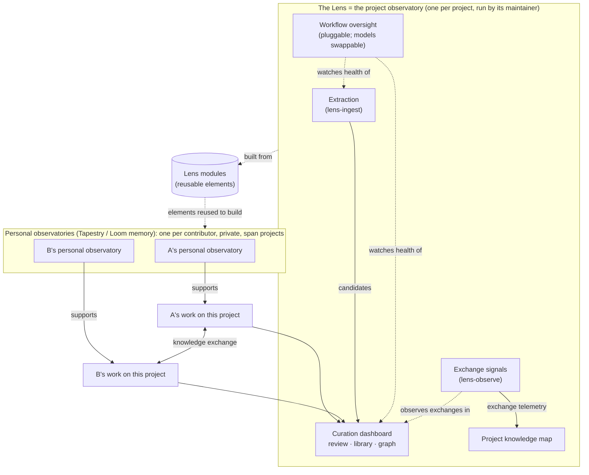

# PROVES → The Lens: module map (A4)

**Made:** 2026-10-20 from A1 [dashboard-inventory.md](dashboard-inventory.md) (dashboard
c484e52), A2 [database-bus.md](database-bus.md) and A3
[backend-inventory.md](backend-inventory.md) (PROVES_LIBRARY 02ab37e).
**Scope rule (operator):** keep *working* and *in-progress* modules; drop *superseded*
versions and *broken old* ones. Labels are neutral working descriptions; the operator
names things. Status: ✅ working · 🚧 in-progress · ⚠️ working but defective.

## 1. The working pipeline (what runs, in order)

Cross-cutting (not a stage; used throughout): access + tenancy (orgs, members, roles,
sign-in), workflow oversight (agent trust, pipeline health, errors), the project observer
(knowledge exchanges), database connection + config. See section 7 for the observation layers.

## 2. Where each piece goes (Lens repos)

## 3. The shared database, by area

Spine (lens-core's standard) = A, B, C, D. The other areas belong to the module that owns
them (E → ingest, F → oversight, G → access, I → serve).

## 4. Every kept module

| Module | Does | Stage / order | Status | Source | Lens repo |
|---|---|---|---|---|---|
| URL discovery + quality pre-scan | finds and scores doc pages, queues them | 1 · first | ✅ | `production/scripts/find_good_urls.py` | lens-ingest |
| Source registry + ingestion UI | add/edit sources, trigger crawls | 1 | ✅ | dashboard R4 | lens-ingest |
| Discovery client UI | calls the queueing API from the dashboard | 1 | ✅ | dashboard R5 | lens-ingest |
| Queueing API | accepts URLs/jobs, queues work | 2 | ✅ | `extraction-api/app.py` | lens-ingest |
| Queue worker | pulls queued URLs, runs extraction | 2 | ✅ (url lists only) | `extraction-api/worker.py` | lens-ingest |
| GitHub crawler | crawls repos into crawl items | 2 | 🚧 | `Version 3/crawl_orchestrator.py` | lens-ingest |
| Notion / Drive / Discord loaders | fetch team sources | 2 | 🚧 | `Version 3/team_loaders.py` | lens-ingest |
| Extraction prompt builder | builds per-source prompts | 3 | 🚧 (output discarded today) | `extraction-api/task_builder.py` | lens-ingest |
| Extraction orchestrator | runs extractor → validator → storage | 3 | ✅ | `Version 3/agent_v3.py` | lens-ingest |
| Extractor tools | fetch + snapshot sources | 3 | ✅ | `Version 3/extractor_v3.py` | lens-ingest |
| Validator | lineage + duplicate checks | 3 | ⚠️ (graph checks broken) | `Version 3/validator_v3.py` | lens-ingest |
| Candidate staging writer | writes pending candidates + epistemics | 4 | ✅ | `storage_v3.py` `store_extraction` | lens-ingest |
| Review queue, desktop | accept/reject/edit candidates | 5 | ⚠️ (reviewer id hardcoded; reviewer input dropped) | dashboard R2 + RPCs `record_review_*` | lens-review |
| Review, mobile | swipe review | 5 | ⚠️ (edits not saved) | dashboard R3 | lens-review |
| Promotion + dry-run report | moves accepted candidates into the library | 6 | ✅ (manual CLI) | `storage_v3.promote_to_core`, `curator/batch_promote_accepted.py`, `analyze_accepted_batch.py` | lens-review |
| Library browse + search | tiles, search, facets over verified entries | 7 | ⚠️ (two stats are random) | dashboard R8 | lens-serve |
| Knowledge graph view | 3D / network graph of the library | 7 | ✅ | dashboard R9 `Graph3D`, U4 Cytoscape 🚧 | lens-serve |
| Ask / chat + evidence | questions over the library, answer sources, attachments | 7 | 🚧 (unmounted) | dashboard U5, U6 | lens-serve |
| MCP read server | agent access to the library | 7 · last | ⚠️ (DB tools likely broken) | `mcp-server/` | lens-serve |
| Peer-reflection metrics | calibration, rejection trends, reviewer patterns | cross-cutting | 🚧 (unmounted) | dashboard U2 + `v_*` views | lens-observe |
| Pipeline stats | is the pipeline moving | cross-cutting | 🚧 (partly mock) | dashboard U3, R9 panels | **NEW (proposed): workflow oversight** |
| Org activity heat map | who is active where in the project | cross-cutting | 🚧 (partly mock) | dashboard U3, R9 panels | lens-observe |
| Error + suggestion logging, diagnostics | records failures and improvement ideas | cross-cutting | ⚠️ (unused / one script broken) | `curator/error_logger.py`, `scripts/` | **NEW (proposed): workflow oversight** |
| Intake health + queue stats | is intake up and draining | cross-cutting | ✅ | `extraction-api/app.py` `/health`, `/queue/stats`, `/jobs/{id}` | **NEW (proposed): workflow oversight** |
| Domain objects + repositories | shared typed access to the library | cross-cutting | 🚧 (tested, unused) | `production/core/` | lens-core |
| DB connection + extraction schema | pooled connection, schema check | cross-cutting | ✅ | `Version 3/database.py`, `schema_validator.py` | lens-core |
| Access + tenancy | orgs, members, roles, active org, sign-in, row security | cross-cutting | ✅ (but weak isolation) | dashboard R1 + auth; DB area G | **NEW (proposed)** |
| Agent oversight + trust | agent capabilities, proposals, trust scores | cross-cutting | ✅ | dashboard R6; DB area F + triggers | **NEW (proposed): workflow oversight** |
| Admin health/policy panels | — | — | mock only (not a module) | dashboard R7 | dropped |

**Excluded as superseded or dead:** Version 2, `process_extractions_v3.py`, the second
worker `production/worker/extraction_worker.py` (keep its one idea: claiming jobs safely),
the old in-process task runner, curator-agent, Notion/Neon tooling, the legacy review queue
(`PendingExtractions` + `record_human_decision`), the SQL `promote_to_verified_knowledge`,
the graph helper on `kg_nodes` (table never existed live), mock leftover screens.

## 5. Same data stored in several tables (needs one choice each)

These are **database tables**, not AI. In each case PROVES stores one kind of information
in more than one table; the neutral standard should keep one.

| Kind of data | Where PROVES stores it | Which the working code uses |
|---|---|---|
| Relationships between entries | `staging_relationships`, `knowledge_component_relationships`, `core_equivalences`, `kg_relationships` | graph view + promotion use `core_equivalences`; the staging writer leaves relationships unused |
| Aliases (other names for an entry) | `entity_alias` (points at candidates), `knowledge_enrichment` rows of type alias, view `entity_aliases` | promotion reads `entity_alias` and writes `knowledge_enrichment` |
| Review state of a candidate | `staging_extractions.status`, `staging_extractions.review_decision`, `validation_decisions.decision`, `improvement_suggestions.review_decision` | dashboard reads `status` + the latest `validation_decisions` row |
| Groups of people | `organizations` + `organization_members` vs `teams` + `team_members` | only organizations exist in the live DB |
| Proposed improvements | `improvement_suggestions` vs `agent_proposals` | dashboard uses `agent_proposals` |

## 6. Documentation agent per repo

Every Lens repo (currently 5; more if the new modules become repos) gets a documentation
agent and a docs-site skeleton modeled on Tapestry's `apps/docs-site` (see
[`../tapestry-docs-precedent.md`](../tapestry-docs-precedent.md)). Tapestry has no docs agent
to copy, so it is built: agent definition + `/docs-update` command + a nudge when code
changes without docs, writing Starlight pages (start / how-to / explanation / reference /
systems) for the modules that repo owns.

## 7. Observation layers (operator, 2026-10-21)

More than one layer is observed. **The Lens, with all its modules, is the project observer:
the larger, shared observatory for one project.** Tapestry and Loom memory plan to build the
smaller **personal observatories** from elements of the Lens. Evaluation:
[`../evaluations/2026-10-21-observation-layers.md`](../evaluations/2026-10-21-observation-layers.md).

| Layer | Observes | For whom | Home |
|---|---|---|---|
| Project observatory | knowledge exchanges between contributors and agents at the project's shared interfaces, and the knowledge they produce | the project; builds its knowledge map | **the Lens as a whole** (all modules below) |
| · extraction | feeds candidates to the curation dashboard | — | lens-ingest |
| · review + library | human verification of what was extracted | contributors | lens-review, lens-serve |
| · exchange signals | how knowledge moves between contributors (reviewer patterns, calibration, activity) | the project | lens-observe |
| · workflow oversight | health of the extraction pipeline and the dashboard; agent trust | the maintainer | NEW (proposed) repo; pluggable slot, models swappable |
| Personal observatory | one contributor's work across all their projects; private | the contributor | built by Tapestry / Loom memory from Lens elements; not in PROVES |

Boundary rule: the project observatory sees only what happens at the project's shared
interfaces. A personal observatory keeps everything else private.

Reuse rule: because personal observatories will be assembled from Lens modules, each Lens
module must stay neutral about scale (one person or one project), take its connection
injected, and keep its interface to what it touches on the bus.

